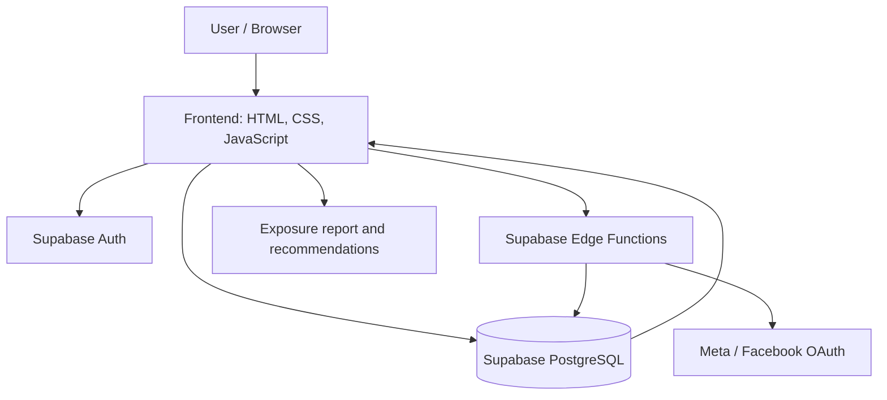

# Digital Shield — Digital Footprint Awareness

A privacy-focused web application that helps users understand social-media exposure and make more informed decisions about their online presence.

**Live website:** https://gajremithali.github.io/Digital-Shield/  
**Repository:** https://github.com/gajremithali/Digital-Shield

## Overview

Digital Shield follows a consent-first workflow: users create an account, review the analysis notice, select social platforms, and view a report based on signals available to the application. The project aims to make digital-footprint concepts understandable through a visual dashboard, transparent scoring, and practical privacy guidance.

The application does not request social-media passwords, collect private messages, or collect device screen-time data.

## Features

- **Account access:** registration, sign-in, session persistence, and sign-out through Supabase Auth.
- **Consent and platform selection:** users review the analysis scope and can see which platform options are not yet available.
- **Connection management:** connection status is displayed and saved connections can be disconnected.
- **Exposure report:** presents available profile signals, platform coverage, exposure indicators, and recommendations.
- **Explainable score:** calculated from available boolean signals stored for the signed-in user. Missing values are excluded; if no assessable signals exist, no score is shown.
- **Personal-account guidance:** Instagram personal accounts can receive a guidance-only safety review rather than a fabricated API-based score.
- **Admin interface:** provides a protected dashboard view for aggregate metrics, app selections, accounts, and session activity when the required Supabase RPC and policies are configured.

## How the score is calculated

The frontend uses these weighted indicators:

| Indicator | Weight |
| --- | ---: |
| Public profile | 18 |
| Contact visibility | 18 |
| Location visibility | 12 |
| External link | 10 |
| Sensitive bio information | 12 |
| Public activity | 12 |
| Weak privacy settings | 18 |

Only values explicitly stored as `true` or `false` are assessed. A `true` value adds its weight to the exposure total. Unknown values are excluded from both numerator and denominator. The result is a percentage of the signals assessed—not a universal measure of a person's overall online risk.

## Technology stack

| Layer | Technology |
| --- | --- |
| Frontend | HTML5, CSS3, vanilla JavaScript |
| Backend services | Supabase |
| Authentication | Supabase Auth |
| Database | Supabase-hosted PostgreSQL |
| Server-side functions | Supabase Edge Functions (Deno / TypeScript) |
| External API | Meta Graph API (basic Facebook profile flow in checked-in functions) |
| Hosting | GitHub Pages |
| Client library | Supabase JavaScript client v2 |

This repository contains a single-page HTML/CSS/JavaScript application. It does not use React, Angular, Vue, or another frontend framework.

## Architecture



The frontend uses the Supabase JavaScript client for authentication and user-scoped database access. The checked-in Facebook Edge Functions validate the signed-in user, create and verify a signed, time-limited OAuth state, exchange the authorization code server-side, request basic profile information, and save the returned signal and connection record.

## Integration status

This status is based on files currently present in this repository:

| Platform | Verified in repository |
| --- | --- |
| Facebook | OAuth start and callback Edge Function source is included. The start function requests `public_profile`; the callback stores basic profile metadata. This is not a full privacy-settings or post-history audit, and the saved Facebook fields do not currently provide the boolean indicators needed for a Facebook exposure score. |
| Instagram | Frontend connection entry point and personal-account guidance mode are present. Instagram Edge Function source is not included here, so a working professional-account API integration cannot be verified from this repository. |
| YouTube | Frontend authorization entry point and a setup note are present. YouTube Edge Function source is not included here, so the integration is not complete in this checkout. |
| Spotify | Marked as coming soon; the client ID is blank in the checked-in frontend. |
| WhatsApp, Snapchat, X, Pinterest, Reddit | Shown as unavailable / coming soon; no working integration is included here. |
| Device screen-time data | Not collected. |

OAuth consent does not guarantee access to every profile field or privacy setting. Available data depends on each provider's API, account type, approved permissions, and app-review status. Interpret the report only within the coverage it displays.

## Repository structure

```text
Digital-Shield/
├── index.html
├── README.md
├── YOUTUBE_OAUTH_SETUP.md
└── supabase/
    └── functions/
        ├── facebook-start/
        │   └── index.ts
        └── facebook-callback/
            └── index.ts
```

## Run locally

The frontend is a static page and has no Node.js build step.

```bash
git clone https://github.com/gajremithali/Digital-Shield.git
cd Digital-Shield
python -m http.server 8000
```

Open http://localhost:8000 in your browser.

A working deployment also requires a configured Supabase project. The checked-in frontend references a Supabase project URL and publishable client key. Authentication, database tables, row-level security policies, the admin RPC, and deployed Edge Functions must be configured separately. The database schema and RLS policy definitions are not included in this repository, so cloning the frontend alone does not recreate the complete backend.

## Supabase and OAuth setup

- Configure Supabase Auth redirect URLs for local development and the deployed website.
- Configure the database objects referenced by the frontend, including `social_signals`, `app_connections`, and `sessions`.
- Enable and test row-level security so users can access only their own records. Restrict administrative data through server-side authorization.
- Deploy the checked-in `facebook-start` and `facebook-callback` functions and configure their Facebook app credentials, redirect URI, and OAuth state secret as Supabase secrets.
- Keep service-role keys, OAuth client secrets, and state-signing secrets server-side. Never commit them or place them in `index.html`.
- `YOUTUBE_OAUTH_SETUP.md` is a setup note; it does not replace the missing YouTube function source.

## Security and privacy

The browser-facing Supabase publishable key is intended for client use, but it does not replace database security. Correct row-level security and least-privilege policies are essential. Keep privileged keys and OAuth secrets on the server. A successful sign-in or account connection does not mean that all exposure information has been retrieved.

## Project status

Digital Shield is an evolving academic web project / prototype. The repository contains the frontend workflow, Supabase authentication and data-access integration, weighted signal calculation, reporting interface, admin interface, and Facebook OAuth function source. Some provider integrations and backend database configuration remain incomplete or external to this repository.
